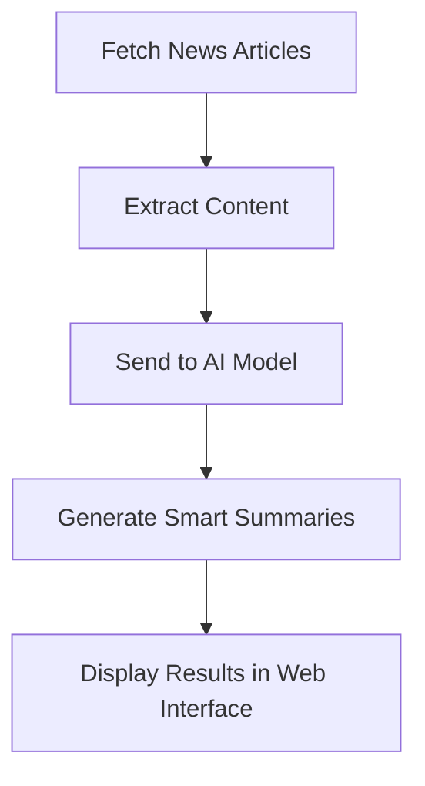

# 🤖 AI News Agent

<div align="center">


### 🧠 AI-Powered Technology News Summarizer

An intelligent automated system that fetches, analyzes, and summarizes the latest AI and technology news using modern Large Language Models (LLMs).

</div>

---

# 📌 Overview

**AI News Agent** is an AI-powered application designed to collect the latest technology and artificial intelligence news from multiple sources, process the content, and generate concise, structured summaries.

The project aims to provide users with a clean and fast way to stay updated with:

* Artificial Intelligence
* Technology News
* Startups & Innovation
* AI Tools & Trends
* Software & Development Updates

All through a modern and lightweight web interface.

---

# ✨ Features

## 📰 Automated News Scraping

* Fetches the latest tech news automatically
* Supports multiple news sources
* Extracts titles, content, images, and links

## 🧠 AI Summarization

* Generates AI-powered summaries
* Extracts key insights from articles
* Presents concise and readable content

## 🌐 Clean Web Interface

* Built with Flask Templates
* Simple and user-friendly design
* Organized news display

## ⚡ Fast & Lightweight

* Optimized performance
* Minimal resource usage
* Easy to customize and extend

---

# 🛠️ Tech Stack

| Technology     | Purpose                |
| -------------- | ---------------------- |
| Python         | Backend Development    |
| Flask          | Web Framework          |
| LangChain      | AI Workflow Management |
| Groq API / LLM | AI Summarization       |
| BeautifulSoup  | Web Scraping           |
| Requests       | HTTP Requests          |
| HTML/CSS       | Frontend UI            |

---

# 📂 Project Structure

```bash id="8mwjx5"
ai-news-agent/
│
├── app.py
├── requirements.txt
├── .env
│
├── scraper/
│   ├── news_scraper.py
│   └── sources.py
│
├── summarizer/
│   ├── ai_summary.py
│   └── prompts.py
│
├── templates/
│   ├── index.html
│   └── news.html
│
├── static/
│   ├── css/
│   ├── js/
│   └── images/
│
└── README.md
```

---

# ⚙️ Installation & Setup

## 1️⃣ Clone the Repository

```bash id="fd87gf"
git clone https://github.com/ahmadnazzal22/ai-news-agent.git

cd ai-news-agent
```

---

## 2️⃣ Create a Virtual Environment

```bash id="w5wv5t"
python -m venv venv
```

---

## 3️⃣ Activate the Environment

### Windows

```bash id="rk7l8o"
venv\Scripts\activate
```

### macOS / Linux

```bash id="9v8iy8"
source venv/bin/activate
```

---

## 4️⃣ Install Dependencies

```bash id="4sn3np"
pip install -r requirements.txt
```

---

## 5️⃣ Configure Environment Variables

Create a `.env` file and add your API key:

```env id="dw7g4k"
GROQ_API_KEY=your_api_key
```

---

## 6️⃣ Run the Application

```bash id="3b4k6z"
python app.py
```

Open your browser and visit:

```bash id="ntm5mk"
http://127.0.0.1:5000
```

---

# 🧠 How It Works



---

# 📸 UI Preview

## 🏠 Homepage

* Latest AI and Tech News
* Clean card-based layout
* AI-generated summaries

## 📄 Article Page

* Full article content
* Highlighted key points
* External source links

---

# 🚀 Future Improvements

* ✅ Dark Mode Support
* ✅ User Authentication
* ✅ Multi-language Support
* ✅ AI Category Classification
* ✅ Real-time News Updates
* ✅ Save Favorite Articles
* ✅ React Frontend Version
* ✅ Docker Deployment

---

# 🔥 Recommended Enhancements

## 🎨 Frontend Improvements

Consider integrating:

* Bootstrap 5
* Tailwind CSS
* React.js

## 🧠 Advanced AI Features

Add:

* Sentiment Analysis
* AI-based Tagging
* Trending Topic Detection
* Personalized Recommendations

---

# 🐳 Docker Support

## Dockerfile

```dockerfile id="5m6ic3"
FROM python:3.11

WORKDIR /app

COPY . .

RUN pip install -r requirements.txt

CMD ["python", "app.py"]
```

---

## Build & Run Docker

```bash id="8hhlhi"
docker build -t ai-news-agent .

docker run -p 5000:5000 ai-news-agent
```

---

# ☁️ Deployment

## Deploy on Render

1. Push the project to GitHub
2. Connect the repository to Render
3. Add environment variables
4. Deploy the application 🚀

---

# 🤝 Contributing

Contributions are welcome!

```bash id="8ur6g7"
Fork → Clone → Create Branch → Commit → Pull Request
```

---

# 📄 License

This project is licensed under the MIT License.

---

# 👨‍💻 Developer

<div align="center">

## Ahmad Nazzal

AI Enthusiast • Python Developer • Backend Engineer

</div>

---

# ⭐ Support

If you like this project:

🌟 Star the repository
🍴 Fork the project
📢 Share it with others

---

<div align="center">

### Made with ❤️ using Python & AI

</div>
