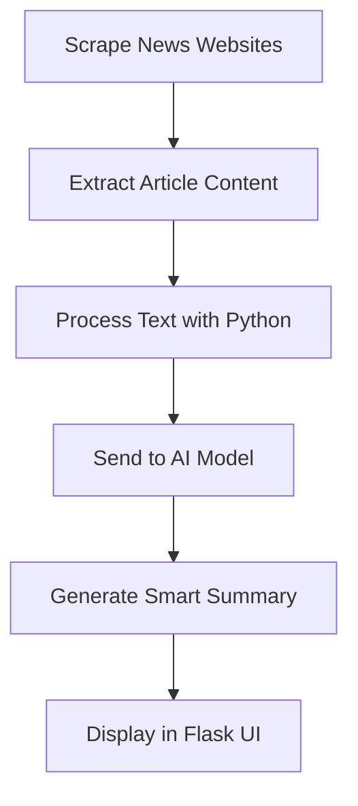

# 🤖 AI News Agent

<div align="center">


### 🧠 AI-Powered Technology News Summarizer

An intelligent automated system that fetches, analyzes, and summarizes the latest AI and technology news using modern Large Language Models (LLMs).

</div>

---

# 📌 Overview

**AI News Agent** is a Python-based AI application designed to collect the latest technology and artificial intelligence news from multiple sources, process the content, and generate concise, structured summaries automatically.

The project combines:

* Web scraping
* Natural Language Processing (NLP)
* AI summarization
* Flask web development

to deliver a modern AI-powered news experience.

---

# ✨ Features

## 📰 Automated News Scraping

* Fetches the latest tech news automatically
* Supports multiple news sources
* Extracts titles, descriptions, images, and links

## 🧠 AI Summarization

* Generates AI-powered summaries using LLMs
* Extracts key insights from articles
* Produces clean and readable summaries

## 🌐 Flask Web Interface

* Responsive and lightweight UI
* Built using Flask Templates
* Organized article cards and summaries

## ⚡ Python Backend Features

* REST-friendly structure
* Modular Python architecture
* Easy integration with APIs
* Environment variable support

---

# 🛠️ Python Libraries Used

| Library          | Purpose                   |
| ---------------- | ------------------------- |
| `Flask`          | Web framework             |
| `requests`       | HTTP requests             |
| `beautifulsoup4` | HTML parsing & scraping   |
| `langchain`      | AI workflow orchestration |
| `python-dotenv`  | Environment variables     |
| `groq`           | LLM API integration       |

---

# 📦 Requirements

```txt id="nqg0gn"
Flask
requests
beautifulsoup4
langchain
python-dotenv
groq
```

Install manually:

```bash id="k3vkza"
pip install Flask requests beautifulsoup4 langchain python-dotenv groq
```

---

# 📂 Project Structure

```bash id="m90njm"
ai-news-agent/
│
├── app.py
├── requirements.txt
├── .env
│
├── scraper/
│   ├── news_scraper.py
│   ├── parser.py
│   └── sources.py
│
├── summarizer/
│   ├── ai_summary.py
│   ├── prompts.py
│   └── llm.py
│
├── templates/
│   ├── index.html
│   └── article.html
│
├── static/
│   ├── css/
│   ├── js/
│   └── images/
│
└── README.md
```

---

# ⚙️ Installation & Setup

## 1️⃣ Clone the Repository

```bash id="pqj19u"
git clone https://github.com/ahmadnazzal22/ai-news-agent.git

cd ai-news-agent
```

---

## 2️⃣ Create Virtual Environment

```bash id="jlwm94"
python -m venv venv
```

---

## 3️⃣ Activate Environment

### Windows

```bash id="f7g0pk"
venv\Scripts\activate
```

### macOS / Linux

```bash id="5gwxzw"
source venv/bin/activate
```

---

## 4️⃣ Install Dependencies

```bash id="m0y8gw"
pip install -r requirements.txt
```

---

## 5️⃣ Configure Environment Variables

Create a `.env` file:

```env id="txmb4n"
GROQ_API_KEY=your_api_key
```

---

## 6️⃣ Run the Flask Application

```bash id="oklmwm"
python app.py
```

Visit:

```bash id="8dztw7"
http://127.0.0.1:5000
```

---

# 🧠 Example Python Code

## Fetch News Articles

```python id="jlwmg8"
import requests
from bs4 import BeautifulSoup

url = "https://example.com"

response = requests.get(url)

soup = BeautifulSoup(response.text, "html.parser")

titles = soup.find_all("h2")

for title in titles:
    print(title.text)
```

---

## AI Summarization Example

```python id="h6nrqw"
from groq import Groq

client = Groq(api_key="YOUR_API_KEY")

response = client.chat.completions.create(
    model="llama3-70b-8192",
    messages=[
        {
            "role": "user",
            "content": "Summarize this article"
        }
    ]
)

print(response.choices[0].message.content)
```

---

# 🧠 How It Works



---

# 🚀 Future Improvements

* ✅ AI sentiment analysis
* ✅ News categorization
* ✅ Real-time updates
* ✅ User authentication
* ✅ Bookmark articles
* ✅ Dark mode
* ✅ REST API support
* ✅ PostgreSQL database integration
* ✅ Docker deployment

---

# 🐳 Docker Support

## Dockerfile

```dockerfile id="zswfkk"
FROM python:3.11

WORKDIR /app

COPY . .

RUN pip install -r requirements.txt

CMD ["python", "app.py"]
```

---

# ☁️ Deployment

## Deploy on Render / Railway / VPS

### Run with Gunicorn

```bash id="l14lxg"
pip install gunicorn

gunicorn app:app
```

---

# 🤝 Contributing

Contributions are welcome!

```bash id="xxa3ie"
Fork → Clone → Create Branch → Commit → Pull Request
```

---

# 📄 License

This project is licensed under the MIT License.

---

# 👨‍💻 Developer

<div align="center">

## Ahmad Nazzal

🐍 Python Developer
🧠 AI Enthusiast
⚡ Backend Engineer

</div>

---

# ⭐ Support

If you like this project:

🌟 Star the repository
🍴 Fork the project
📢 Share it with others

---

<div align="center">

### Built with Python, Flask & AI ❤️

</div>
